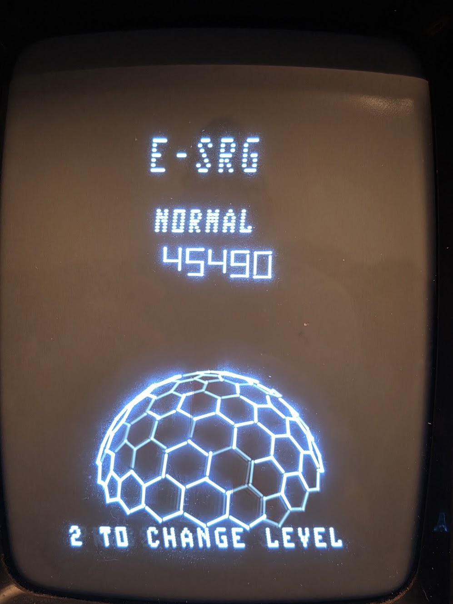
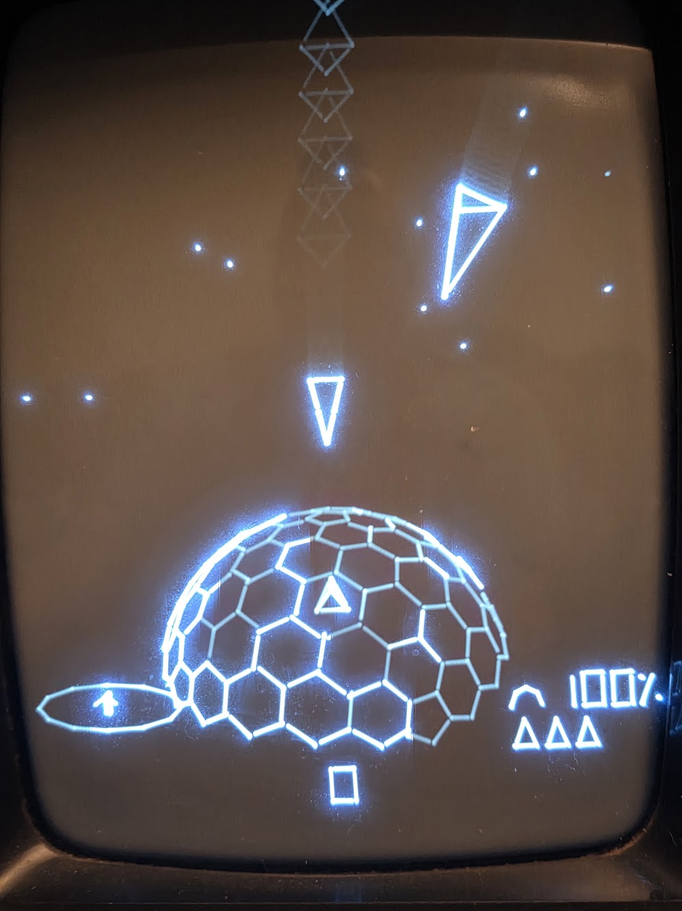

# E-SRG
- "The Elite-Style Radar Game"
- Pronounced "e-surge"

A game for the **Vectrex** (GCE, 1982): defend a rotating geodesic dome from
incoming missiles. It's a native 6809 cartridge ROM (`.bin`), so it runs on
a real Vectrex from any flash/multicart (UVMC2, VecMulti, ...) and in
emulators (RetroArch's vecx core, MAME, VIDE).

- Move around the dome with the stick, jump over cracks (button 2), and
  shoot the missiles (button 1) before they crack its tiles.
- Cracks spread: a tile cracks when enough of its neighbours have. At 0%
  integrity the dome collapses.
- The radar (lower left) shows missiles before they're on screen and
  blinks and beeps when you're lined up with one.
- Score: 1000 points per missile times the dome's integrity. Missiles get
  faster as the score grows (EASY's start and stay a quarter slower).
- Three levels (button 2 on the title screen), each with its own high
  score. NORMAL's is kept in the BIOS high-score slot, so it survives a
  reset (and, on a UVMC2, a power cycle).

## Background

One of the first commercial games that I got for my first computer, a C64, was Elite.  (The very first
was Gridrunner.) Like many others, I put many hours into Elite. A few years later, everyone was
suddenly talking about Wing Commander, and I couldn't understand why.  Wing Commander had a few pre-rendered
angles for the enemy ships and a crappy 2D radar.  Why would anyone want to play that, when they
could have "smooth" vector graphics that rendered every possible angle of objects and the awesome
3D radar that showed you exactly where everything was relative to your own ship?  Anyway, I see in
the screenshots for Squadron 42 that they're now using the Elite-style radar, so clearly I was right
all along. :)  

Anyway, I've been thinking about ways to incorporate an Elite-style radar into a game of my own for
decades now, and the Vectrex seems like the ideal place for such a tribute.  I'm a programmer by day,
but that's "Enterprise Java", and I've never had the time and energy to apply myself to learn C and 
assembly to the extent I'd need for a project like this.  But I use Claude Code at work as well, so I 
figured "he" could help me with this.  I'm pretty happy with how this has turned out.  I hope you
enjoy it!

## On a real Vectrex

[Gameplay video on YouTube](https://www.youtube.com/watch?v=tprYcejVHpM)

<p>


</p>

- Game design: John Emmer.
- Implementation: Claude Code, using Opus 5.5, working with
  the designer.
- Built with gcc6809, ASxxxx, Peer Johannsen's PeerC runtime and
  Malban's VIDE.

Ready-made ROMs are on the releases page: `e-srg-<version>v.bin` for a
Vectrex, `e-srg-<version>e.bin` for emulators.

Developer notes (how the game is built, traps, budgets):
[AGENTS.md](AGENTS.md).

## Requirements

- **Linux x86-64.** The compiler and assembler come from VIDE's Linux
  build; other platforms would need their own `cc1`/`as6809`/`aslink`.
- **[VIDE 2.5](http://vide.malban.de/)** (Malban's Vectrex IDE), unpacked
  anywhere. The build uses its gcc6809 (`C/Linux64/bin/`) and PeerC
  (`C/PeerC/`). Point `VIDE_DIR` at its `Vide.u64` folder (default
  `~/Development/Vide2.5.u64/Vide.u64`):
  `make VIDE_DIR=/path/to/Vide.u64`, or export it.
- **Python 3** with **numpy** and **Pillow** (`tools/gen_dome.py`, the test
  harness).
- **gcc** (the headless test host, `tests/vxhost.c`).
- For `make run` / `make test`: **RetroArch** with the **vecx** core.
  The default core path is the Flatpak's
  (`~/.var/app/org.libretro.RetroArch/config/retroarch/cores/vecx_libretro.so`);
  for another install set `CORE=` (make run) and `VECX_CORE=` (make test).
  The core has the Vectrex BIOS built in.
- Optional: MAME (`make mame`, Flatpak; needs `vectrex.zip` in
  `MAME_ROMS`), VIDE's emulator (`make vide`), ES-DE (`make esde`).

The generated tables (`src/dome_data.*`, `src/missile_data.*`, `*_cfg.inc`)
are committed; `tools/gen_dome.py` remakes them after changing its settings.

## Why Vectrex-native

A 6809 cartridge ROM runs on every Vectrex setup; ARM games for a specific
cartridge (UVMC2 `.um2`, PiTrex) only run on that one.

## Toolchain

- **gcc6809** — VIDE's bundled GCC 4.3.6 (`cc1` + `as6809`/`aslink`)
  with Peer Johannsen's PeerC runtime, driven outside VIDE by
  `toolchain/gcc6809-driver.sh`. The winner of the
  [cmoc-vs-vbcc-vs-gcc6809 comparison](https://vectrex.substack.com/p/cmoc-vs-vbcc-vs-gcc6809):
  smallest/fastest 6809 code (the same "hello" was 1018 bytes vs 1503 with
  cmoc).
- **What we take from VIDE** (all under `Vide.u64/C/`): the
  compiler `cc1` and the ASxxxx tools `as6809`/`aslink`/`srec2bin`
  (`Linux64/bin/`), libgcc's 16-bit divide (`PeerC/lib/`), PeerC's
  headers, its startup code `crt0.c` and its BIOS symbol tables
  (`vec_ram_*`, `vec_rom_*`, `vec_rum_0x*`: addresses only, no code).
  PeerC's BIOS wrappers (`vec_rum_fct_pjc.c`) and `gcc.c` (memcpy etc.) are
  left out (`PEERC_SKIP` in the Makefile) because aslink links every module
  whole: they cost ~875 bytes for 3 wrappers we use, now in `src/bios.s`.
  Using another BIOS routine that takes arguments needs its wrapper added
  there (copy PeerC's from `vec_rum_fct_pjc.c`); the link fails with
  "Undefined Global" otherwise. VIDE and PeerC aren't part of this
  repository; they're used from your VIDE install under their own terms.

## Build & test

```sh
make            # build/e-srg-1.1.0v.bin: for a typical Vectrex (the release ROM)
make mine       # build/e-srg-1.1.0m.bin: preset for one particular Vectrex
make run        # build build/e-srg-1.1.0e.bin (emulator setting) and run it
make emu        # just build build/e-srg-1.1.0e.bin
make test       # headless: the emulator ROM must start and draw; writes a PNG
```

The ROM names carry the version (`GAME_VERSION` in `src/e-srg.c`; the
Makefile reads it from there) and the build: **v** typical Vectrex, **e**
emulator, **m** one particular console (yours, once you set it). The boot screen shows the same, e.g. `V1.1.0M`
under the name. On the UVMC2 renaming a ROM keeps its high score, but each
new build starts from 0 (see "The number at the top of the boot screen"
below).

The ROMs differ only in the dome's calibration. A real Vectrex's beam keeps
moving a little after each stroke (the "ramp tail", ~2.5-4 cycles,
different per console); vecx's stops dead, which no real console does. So:
the **v** ROM assumes a typical tail (2.5 cycles, `TAIL_DEFAULT` in
`tools/gen_dome.py`), **m** uses the tail measured on one console
(`TAIL_MINE`), and **e** none (`-DDOME_NO_TAIL`). On any console, hold
button 4 and push the stick left/right until the dome's lines meet. The
CAL value isn't stored: to build a ROM for your own console, set
`TAIL_MINE` from it (CAL = 64 + 3 x tail, so tail = (CAL - 64) / 3),
run `python3 tools/gen_dome.py`, then `make mine`.

## Other emulators

All three play the emulator ROM, `build/e-srg-<version>e.bin` (built first if needed):

```sh
make mame    # MAME (flatpak): vectrex -cart <rom>; BIOS vectrex.zip from MAME_ROMS
make vide    # VIDE's emulator: tools/vide-run.sh starts VIDE with -bi=<rom> -ex+
make esde    # copy it to ES-DE's Vectrex folder as E-SRG.bin (ESDE_VECTREX)
```

MAME's own menu only lists cartridges in its built-in software list, so a
loose `.bin` never appears there: start it with `-cart`. In ES-DE, the
Vectrex system runs vecx by default; MAME is listed as an alternative
emulator (per game: the game's metadata editor → "Alternative emulator";
for all Vectrex games: Main menu → Other settings → Alternative emulators).
After `make esde`, rescan or restart ES-DE to see E-SRG.

## Test builds

For a one-off experiment,
`GAME=name` renames the ROMs (`build/name-<version>v.bin` etc.) and
`GCC_FLAGS` adds options:

```sh
make run GAME=e-srg-2x GCC_FLAGS="-DMIS_SPEED_TEST=164"   # build/e-srg-2x-1.1.0e.bin
```

Always pass the same `GCC_FLAGS` the ROM was built with: if any source
changed since, `make run GAME=e-srg-2x` alone rebuilds it *without* them.

Test options (in `src/e-srg.c`): `MIS_SPEED_TEST=n`
(every missile at speed n; 82 = 1x, 164 = 2x), `CRACK_TEST=n` (each game starts with n
tiles broken; 38 = the dome collapses at once), `SCORE_TEST=n` /
`SCORE_TEST_HI=h` (start at score / 10 = h*65536 + n), `AIM_AT_SHIP`,
`NO_CATCHUP`, `NO_RADAR`, `FRAME_STATS` (see `tools/frame_stats.sh`).

## Editing the title screen text

All the title-screen text is in `src/e-srg.c`, in the "title screen" section
(search for `page_controls`):

- **Pages** are arrays of lines: `page_best`, `page_controls`, `page_play`,
  `page_levels`, `page_collapse`, `page_score`, `page_credits`, `page_thanks`. Each line is a string ending in `\x80` (the BIOS's end
  marker; leave it on). `""` is a blank line. The `0` at the end closes the
  page. Lines are centred automatically, top line at y 100, 20 down per line.
- **Columns:** start a line with `\x01` (it isn't printed) and all such
  lines on the page are left-aligned as one block, centred on the longest
  of them. Pad with spaces to line up a second column (the font is
  fixed-width), as on the controls page. If the next character is a hex
  digit (0-9, A-F), close the string after `\x01`: `"\x01" "1      FIRE\x80"`,
  or C reads `\x011` as one character.
- **Characters:** capital letters, digits, space and simple punctuation
  (`. , : - ! ? ( )`). Lowercase doesn't display.
- **Line length:** at most about 22 characters (~10 units each, the screen
  is about 254 wide).
- **Text size:** `TEXT_HEIGHT` / `TEXT_WIDTH` (BIOS defaults -8 / 72), set
  at start. Centring (`text_x`) uses what was measured at that size: ~10
  units per character, ink starting ~9 right of the given x
  (`TEXT_CHAR_W`, `TEXT_INK_X`; re-measure if you change the size).
- **"PRESS 1 TO START"** is at `PRESS_Y` (-124), below the dome.
- **Lines per page:** keep to about 6 text lines (blank ones are free),
  fewer if they're long. BIOS text is slow: 9 lines of up to 21 characters
  took two frames (25 Hz, flickers on the Vectrex). Check with `make test
  TEST_ARGS="--frames 1000 --hold 3@850-852"` (one `--hold 3@...` per page
  turn): "game loop" under ~80 is getting close.
- **Adding or removing a page:** edit `pages[]` and `TITLE_PAGES` together.
  Entry 0 is the title page (no list; it's drawn by `title_screen`).
- **Title page:** the big name is `big_title` (size set by
  `Vec_Text_Height`/`Vec_Text_Width` just before it's printed, position
  `TITLE_Y` and the x in that `Print_Str_d`); "PRESS 1 TO START" is
  `press_text`, printed at `PRESS_Y` under the dome, taking turns (64
frames each) with `level_hint` ("2 TO CHANGE LEVEL"): a third text line
there slowed the page from 93% to 78% of 50 Hz.
- **Levels:** button 2 on any title page (it jumps back to the first) picks EASY / NORMAL / HARD
  (`level_name`, shown at y 60 on the title page with that level's high
  score under it, `BEST_Y`). They differ in how many broken neighbours
  collapse a cell (`COLLAPSE_EASY - level`: 5 / 4 / 3), in what a dome
  collapse costs (`kill_ship`: nothing / a life / the game), and in missile
  speed: EASY uses `speed_easy`, 0.75x of `speed_val` at each score step.
- **High scores:** one per level, on `page_best` (the names are
  `name_easy` etc., the numbers in vector digits at `best_rows_y`). GAME
  OVER returns to that page. Only NORMAL's is kept in the BIOS slot, so
  only it survives a reset (and, on the UVMC2, a power cycle); easy's and
  hard's start at 0 each time the game starts.
- **Timing:** `TITLE_PAGE_FRAMES` (250 = 5 s per page) and
  `GAME_OVER_FRAMES` (how long GAME OVER shows before the title returns).
- **Boot music:** `game_header.music` picks the tune played on the BIOS
  boot screen (`&Vec_Music_7` = Star Trek now). To hear the
  14 BIOS tunes, `make jukebox-run` (emulator) or copy `build/jukebox.bin`
  (`make jukebox`) to the Vectrex: stick chooses, 1 plays, 2 stops, 3 plays
  all; it shows each tune's `Vec_Music_n` symbol.
- **The BIOS boot screen** (the name shown after "VECTREX") is
  `game_header` at the top of the file: `.name` and `.version` lines (each
  with height, width, y, x), and `.copyright`, which must start with `g GCE`
  and the year. The version is `GAME_VERSION` ("1.1.0") plus the build letter
  (`GAME_BUILD`), shown as e.g. V1.1.0V.
- **The number at the top of the boot screen** on the Vectrex is the
  BIOS's high-score slot, which the BIOS prints after a warm start (reset
  button, or a menu cart like the UVMC2 launching the game) but not after
  power-on. The game keeps its high score there (`best_set`; 6 digits, so
  over 999,990 is stored as 999990) and reads it back at start, so the high
  score survives a reset, and relaunching from the UVMC2 menu. Until a game has ended it shows "0". The slot is
  in the console's RAM, and there's only one, shared by every game that
  uses it. The UVMC2 also saves it per ROM, so it survives a power cycle.
  It recognises the ROM by its contents, not its file name (a renamed
  identical copy shows the same score), so each build, even one that
  changes a single byte, has its own high score.
- **Header sizes:** the BIOS starts the game right after the header's last
  title line, so `name`/`version` must be exactly their text's length (no
  room for C's NUL); the build stops with an error otherwise.

The ROM is nearly full (13 bytes free in 1.1.0, built with `-Os`):
`make` prints the size; the cartridge holds 32768 bytes.

## CLion

Open this directory in CLion (set the `VIDE_DIR` CMake cache variable if
VIDE isn't at the default path). The `CMakeLists.txt` does **not** compile
on the host (no 6809 toolchain in CLion) — it wires the Makefile build to the **rom**
target and exposes `run`/`test` targets. Use CLion as an editor
and terminal; there is no 6809 assembly language plugin for CLion.

## Layout

```
src/            game sources (*.c, *.s) — all linked into the gcc6809 ROM
tests/          vxhost.c (headless libretro host), smoke.sh, libretro.h
tools/          gen_dome.py (generates the tables), frame_stats.sh,
                prof_labels.py, analog_sim.py, vecxstat/ (profiling core)
toolchain/      gcc6809-driver.sh
docs/           vector-budget.md: what real Vectrex games draw per frame
build/          build artifacts (gitignored)
```

## License

E-SRG is free software: you can redistribute it and/or modify it under the
terms of the GNU General Public License as published by the Free Software
Foundation, either version 3 of the License, or (at your option) any later
version. See [LICENSE](LICENSE).

`tests/libretro.h` is the libretro API header, under its own MIT license
(in the file). VIDE, gcc6809, ASxxxx and PeerC are not included; the build
uses them from a VIDE install.
